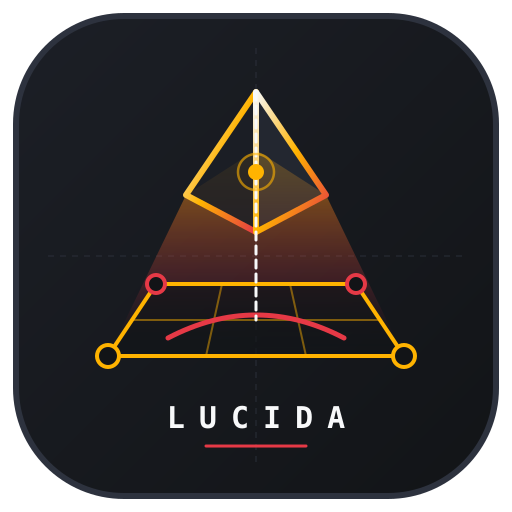

  

# Lucida Studio

Lucida is an Android camera lucida/reference-overlay workspace. It combines a live back-camera preview with an imported drawing reference, alignment tools, tracing grids, and clean still-frame capture.

## Requirements

- JDK 17
- Android SDK Platform 34 and Build Tools installed and accepted
- Gradle 8.6+ (AGP 8.4.1); Kotlin 1.9.24
- Android device/emulator at API 26+ with a camera for the live studio

This source handoff does not include a fabricated Gradle wrapper JAR. With Gradle installed, generate a wrapper once using `gradle wrapper --gradle-version 8.6`, then build and run unit tests with `./gradlew :app:testDebugUnitTest :app:assembleDebug`.

## Features

- CameraX live preview and runtime camera permission request.
- Back-camera torch toggle when supported, a live exposure compensation slider when the camera reports an exposure range, and an AE hold toggle.
- Import image documents through Android's Storage Access Framework; an accepted read grant is persisted when the document provider allows it. Coil SVG support is enabled. Imported software bitmaps are capped at 2048 pixels on the longest side.
- Pinch/pan/rotate overlay, opacity, grid styles, manual four-corner paper alignment with One-Euro-smoothed pins, and saved session/viewport alignment.
- Raw reference, tinted Sobel edge overlay (threshold 10–120), and four-category tonal posterization (all values, shadows, dark midtones, light midtones, highlights).
- Clean still snapshots and timed frame sequences at 5/10/30/60-second intervals. The camera's ImageCapture use case saves frames independently of the Compose HUD.
- Export through the document picker as a ZIP containing JPEGs and `manifest.csv`.
- Volume Down toggles Ghost Lock; volume key repeat is ignored.

## Important limitations

- The sequence recorder exports JPEG frames plus a CSV manifest; it does **not** create an MP4 or a playable video.
- The `AE hold` control requests Camera2 automatic-exposure lock. Autofocus remains continuous; this is not a manual lens-focus lock.
- Four-corner alignment is manual. Pins map the imported reference image onto a stationary sheet; Lucida does not estimate camera motion or track the sheet between frames.
- Camera features depend on runtime permission and device hardware. Torch and exposure adjustment are hidden/disabled when unsupported. CameraX device behavior varies.
- The renderer uses software bitmaps. The longest-side decode cap reduces memory use but may reduce the size/detail of larger source images. Format and provider support were not device-tested in this environment.
- Captures stay in app-private storage until app data is cleared; this implementation does not prune old frames. Export copies them to the user-selected destination.
- This handoff was source-checked only. No Android SDK, Java, Gradle, emulator, or physical phone was available in the authoring sandbox, so APK assembly and on-device validation remain to be run in a configured Android environment.

## Project layout

- `app/src/main/java/com/lucida/studio/MainActivity.kt` — activity and key handling
- `ui/workspace/` — state, intents, persistence-facing screen and view model
- `ui/workspace/components/` — CameraX, gestures, grid, calibration, telemetry, HUD
- `domain/imaging/` — image loader, edge/value renderers, clean frame recorder
- `domain/math/` — One-Euro filters and Android matrix/homography helpers

## Build notes

The app targets API 34, has a minimum API of 26, and uses the CameraX 1.3.3, Compose BOM 2024.05, Coil 2.6.0, and AndroidX DataStore 1.1.1 catalog versions. If the camera controller reports a provider/device exception, check the device's camera permission, availability of a back-facing camera, and supported Camera2 features.
